# Bank Customer Churn Analysis (SQL Server)

A SQL Server project that loads a bank customer dataset, models it into a normalized schema, validates the load, and answers business questions about **why customers leave the bank**.

- **Data source:** [Churn Bank Customers AK (Kaggle)](https://www.kaggle.com/datasets/akelsayed/churn-bank-customers-ak)
- **Dataset author:** Akram ELsayed (Kaggle) | **License:** Apache 2.0
- **Repository:** [BankChurn_SQL_Project (GitHub)](https://github.com/abdonabawy2003-netizen/BankChurn_SQL_Project)

---

## 1. Business Problem

A bank loses customers every year (churn). Winning a new customer costs far more than keeping an existing one, so the bank needs to know:

1. **Who** is leaving (country, gender, age, number of products, activity)?
2. **How much money** leaves with them?
3. **Which customers should we contact now** before they leave?

This project answers these questions with SQL on a dataset of **10,000 customers**.

## 2. Dataset

| Item | Value |
|---|---|
| Rows | 10,000 customers |
| Columns | 14 |
| Target column | `Exited` (1 = customer left, 0 = stayed) |

Columns: `RowNumber`, `CustomerId`, `Surname`, `CreditScore`, `Geography`, `Gender`, `Age`, `Tenure`, `Balance`, `NumOfProducts`, `HasCrCard`, `IsActiveMember`, `EstimatedSalary`, `Exited`.

## 3. Database Structure

The raw CSV is loaded into a **staging table** (`stg` schema) and then split into normalized tables in the `bank` schema.

| Table | Purpose |
|---|---|
| `stg.Churn_Bank_Customers_AK` | Raw data exactly as imported from the CSV |
| `bank.Geography` | Lookup: countries |
| `bank.Gender` | Lookup: gender |
| `bank.Customers` | Customer identity (CustomerId, Surname, Age + FKs) |
| `bank.CustomerFinancials` | CreditScore, Balance, EstimatedSalary, Tenure |
| `bank.CustomerProducts` | NumOfProducts, HasCrCard |
| `bank.CustomerStatus` | IsActiveMember, Exited |

**Relationships:** `Geography` 1:N `Customers`, `Gender` 1:N `Customers`, and `Customers` 1:1 with each of the three detail tables.

### ERD


### Source-to-Target Mapping


Data type decisions: `Balance` and `EstimatedSalary` were converted from `float` to `DECIMAL(18,2)` because money needs fixed precision. Small integers use `TINYINT` / `SMALLINT`, flags use `BIT`, and text uses `NVARCHAR`.

## 4. How to Upload a CSV / Excel File to SQL Server

| Method | When to use |
|---|---|
| **Import Flat File** (SSMS: Tasks > Import Flat File) | CSV, one-time load, auto-detects types (used here) |
| **Import and Export Wizard** | Excel or CSV, needs the Access Database Engine for `.xlsx` |
| **BULK INSERT** | Large CSV files, scripted, table must exist first |
| **OPENROWSET** | Query an Excel file directly from T-SQL |
| **Python (pandas + SQLAlchemy)** | Automated or repeated loads |

## 5. Project Structure

```
.
├── README.md
├── Project_Documentation.md
├── data/
│   └── Churn_Bank_Customers_AK.csv
├── sql/
│   ├── 01_DDL_Insert.sql              # schemas, tables, constraints, data load
│   ├── 02_Validation.sql              # COUNT, TOP 100, TOP 1000, comparison checks
│   ├── 03_Insights_Churn.sql          # who is leaving
│   ├── 04_Insights_Customer_Value.sql # money and customer value
│   └── 05_Insights_Retention_Risk.sql # who to act on now
└── docs/
    ├── ERD.png
    ├── Mapping.png
    └── screenshots/
```

## 6. How to Run

1. Create a database named `BankChurnDB`.
2. Import `data/Churn_Bank_Customers_AK.csv` using **Import Flat File** into table `Churn_Bank_Customers_AK`, then move it to the `stg` schema (the script handles this).
3. Run `sql/01_DDL_Insert.sql`.
4. Run `sql/02_Validation.sql` and confirm the checks pass.
5. Run the insight files `03` to `05` (select one query, press **F5**).

## 7. Validation

| Check | Expected |
|---|---|
| Rows in each table | 3, 2, 10000, 10000, 10000, 10000 (+ 10000 in staging) |
| Customers missing from target | 0 |
| Rows that differ between staging and target | 0 |

Screenshots:

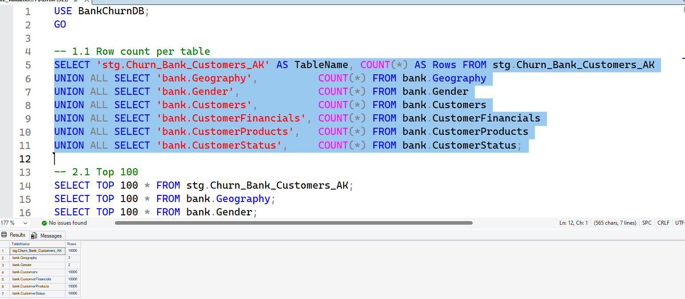
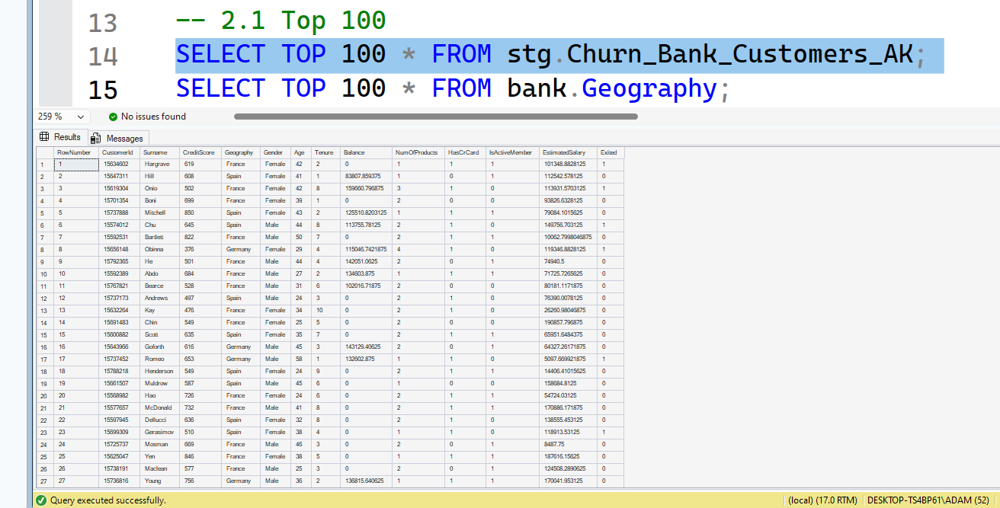
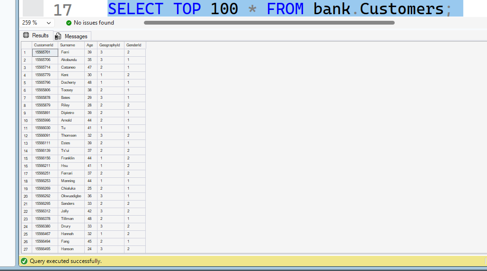
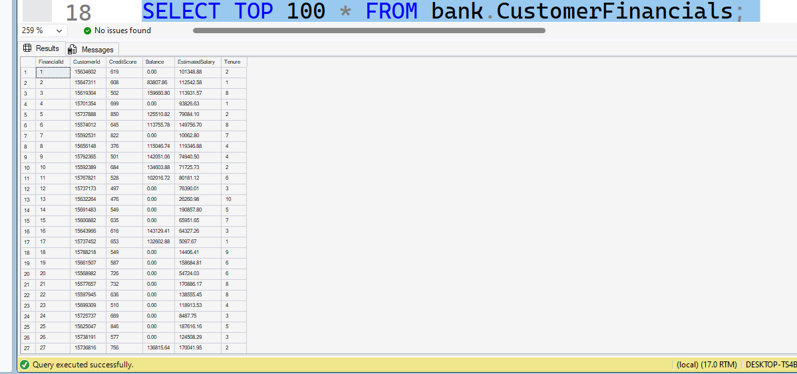

## 8. Business Insights

SQL techniques used: **Joins** (up to 4 tables), **Aggregations**, **GROUP BY**, **HAVING**, and **functions** (`CASE`, `CAST`, `ROUND`, `NULLIF`, `ROW_NUMBER`, CTE).

### Churn analysis (`03_Insights_Churn.sql`)

| Question | Finding |
|---|---|
| Overall churn rate | **20.37%** (2,037 of 10,000 customers left), about 1 in 5 |
| By country | **Germany 32.44%**, Spain 16.67%, France 16.15%. Germany holds ~25% of customers but ~40% of all churn |
| By gender | Female **25.07%** vs male 16.46% |
| By age group | Rises with age: under 30 = 7.56%, 30-39 = 10.88%, 40-49 = 30.79%, **50-59 = 56.04%**, 60+ = 27.95% |
| By number of products | 1 product = 27.71%, **2 products = 7.58%**, 3 = 82.71%, 4 = 100% (only 60 customers) |
| By activity | Inactive members churn at 26.85% |

**Takeaways**
- Germany is the first market to focus retention efforts on.
- Customers aged 40 to 59 are the highest-risk age groups.
- Customers with exactly 2 products are the most loyal, so moving 1-product customers to a second product is a natural retention lever.
- 3 and 4 product customers churn at very high rates. This needs investigation before acting (small sample, possible product or data issue).
- These are correlations, not proof of cause.

Result screenshots:

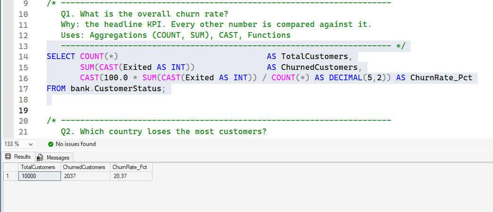
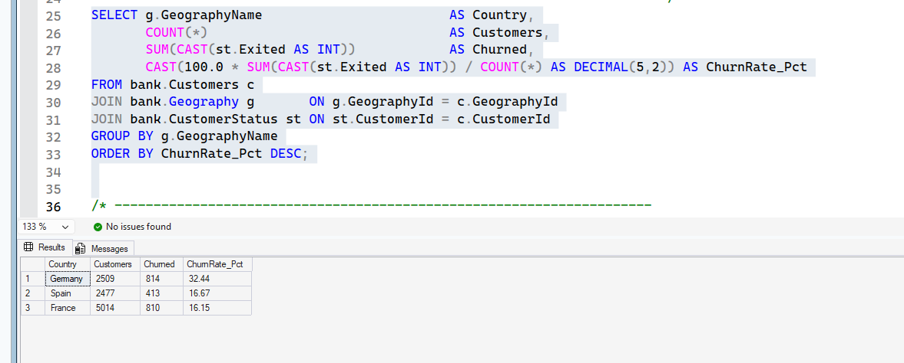
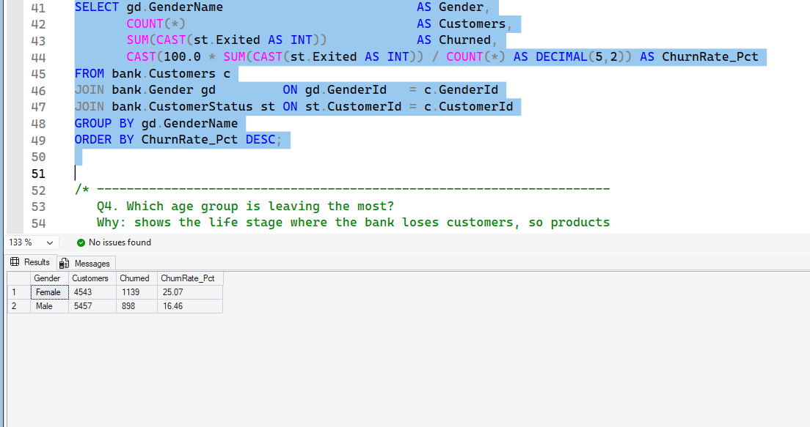
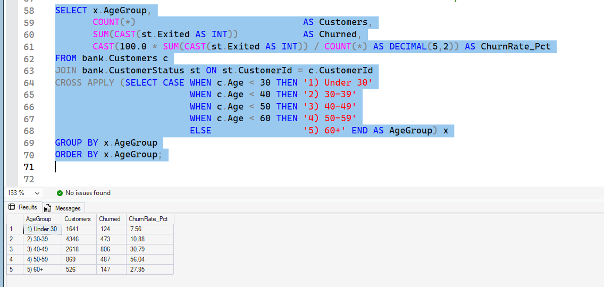

### Customer value (`04_Insights_Customer_Value.sql`)

| Question | Finding |
|---|---|
| Average profile per country | Germany's average balance is **119,730.12**, about twice France (62,092.64) and Spain (61,818.15). Average salary (about 99,000 to 101,000) and average credit score (about 650) are almost the same in all three countries |
| Credit score and churn | Churn is almost flat across credit bands: Poor (<580) 22.02%, Fair 20.56%, Good 18.62%, Very Good 20.59%, Excellent 19.54% |
| Zero-balance customers | **48.41%** of Spanish customers (1,199 of 2,477) and **48.22%** of French customers (2,418 of 5,014) hold a zero balance. Germany does not appear in the result because it has no zero-balance customers |

**Takeaways**
- Germany combines the highest churn (32.44%) with the highest average balance, so each lost German customer costs the bank more money.
- Credit score is not a strong churn driver in this data (all bands are within about 3.4 percentage points).
- Almost half of the French and Spanish customers keep no balance with the bank, so they are candidates for activation campaigns.

Result screenshots:


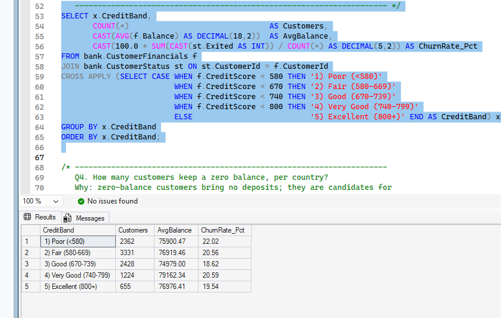
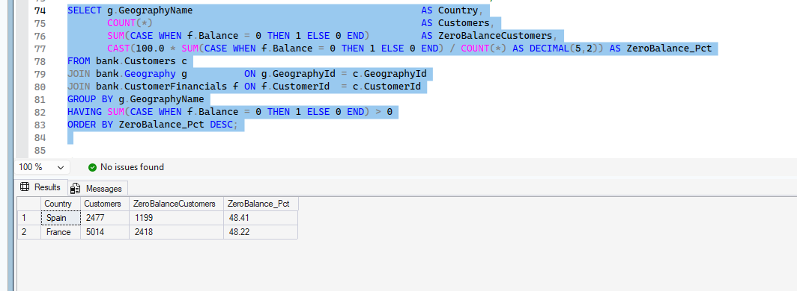

The file also contains queries for balance lost to churn by country, churn by tenure, and the top churned customers by balance.

### Retention and risk (`05_Insights_Retention_Risk.sql`)

**Top 3 richest customers per country:** 3 of these 9 VIP customers have already left, including the largest balance in the dataset (250,898.09, Spain). The bank is losing high-value customers, which justifies a dedicated relationship manager for top-balance accounts.

| Question | Finding |
|---|---|
| Retention targets (still customers, inactive, balance above 100,000) | **1,584 customers** holding about **210.6 million** in balance: France 729 customers (96,995,797.70), Germany 545 (72,291,347.58), Spain 310 (41,339,390.54) |
| Segments with churn above the bank average (20.37%) | Only three: **Germany female 37.55%** (1,193 customers), Germany male 27.81% (1,316), Spain female 21.21% (1,089). No France segment is above average |
| Credit card and activity | Active with card 13.36%, active without card 16.39%, inactive with card 27.32%, inactive without card 25.70% |

**Takeaways**
- Activity matters far more than owning a credit card: inactive customers churn at about 26% to 27% whether or not they have a card, while active customers churn at about 13% to 16%.
- German women are the riskiest segment, with churn about 1.8 times the bank average.
- The 1,584 inactive high-balance customers who have not left yet are the natural list for a retention campaign, starting with France (largest group) and Germany.

Result screenshots:

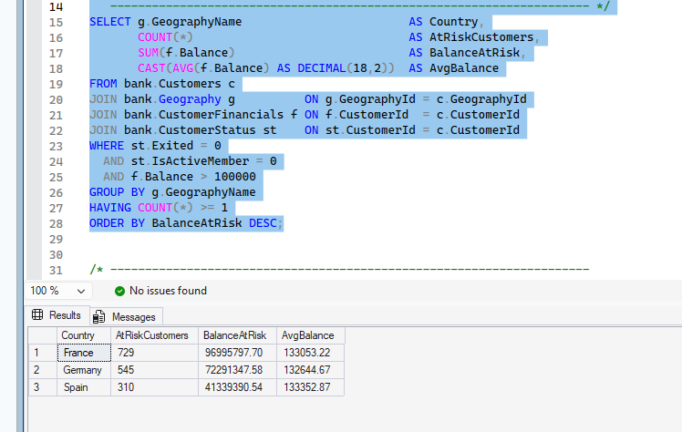
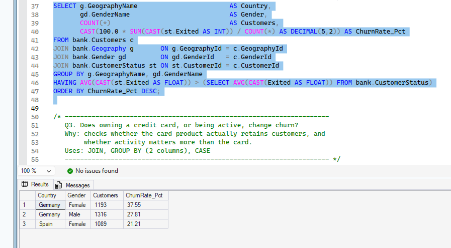
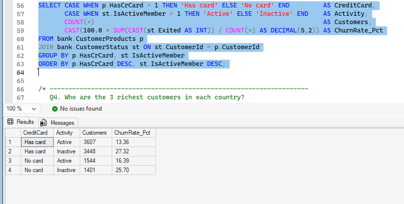
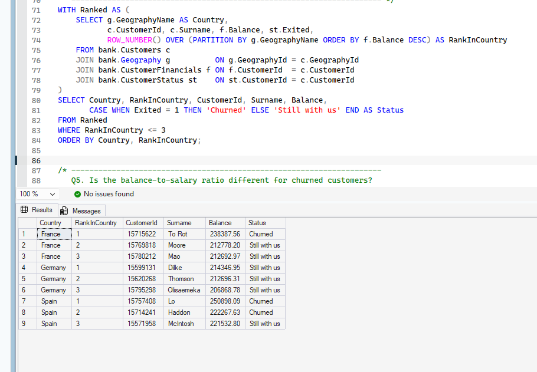

The file also contains a query for the balance-to-salary ratio of churned versus retained customers.

## 9. Tools

SQL Server 2025 (17.0), SQL Server Management Studio, Draw.io (ERD), Git / GitHub.
